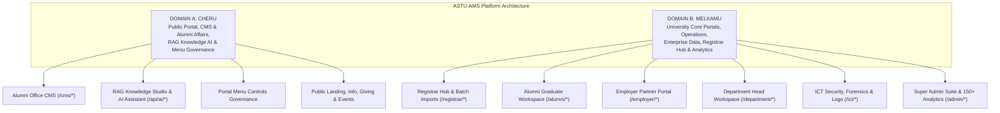

# ASTU-AMS Team Task Division, Dashboard Architecture & Implementation Guide

**Project**: Adama Science and Technology University — Alumni Management System (ASTU-AMS)  
**Document Version**: 1.0.0 (Production Release Preparation)  
**Authors**: Cheru (`chera1606`) & Melkamu (`melkamuwako`)  
**Repository**: `ASTU-STEM/ASTU-AMS`  

---

## 1. Executive Summary & Strategy

The ASTU-AMS platform is an enterprise-scale university portal suite spanning **75+ pages and views across 5 primary actor roles** (Alumni, Employers, Registrar, Department Heads, ICT Admin) plus **Executive Super Admin** and **Alumni Office CMS**.

To prevent overlapping file edits, eliminate Git merge conflicts, and achieve high code quality and fast delivery, this document establishes:
1. **Clear Division of Responsibility**: Non-overlapping domains assigned to Cheru and Melkamu.
2. **Decomposition Pattern for Large Files**: How to systematically refactor monolithic 2,000–6,400 line files into lightweight tabbed architectures.
3. **UI/UX & Data Integrity Standards**: Strict verification criteria for contrast, responsive layouts, real API wiring, and state handling.
4. **Git Branching & Integration Protocol**: Collaborative workflows ensuring zero merge collisions.

---

## 2. Master Division Matrix: Cheru & Melkamu



### High-Level Responsibility Mapping

| Module / Area | Owner | Primary File / Directory | Target Route |
| :--- | :--- | :--- | :--- |
| **Alumni Office CMS Hub** | **Cheru** | `frontend/src/features/admin/pages/` | `/cms/*` |
| **RAG Knowledge Hub & Public AI** | **Cheru** | `backend/src/modules/ai/` & `frontend` | `/cms/knowledge-hub`, `/`, `/api/ai/*` |
| **Portal Page Menu Governance** | **Cheru** | `frontend/src/context/PortalMenuControlContext.tsx` | `/cms/menu-controls` |
| **Public Showcase, Community & Giving** | **Cheru** | `frontend/src/pages/HomePage.tsx`, `AboutPage.tsx` | `/`, `/about`, `/partners`, `/donations` |
| **Registrar Management Hub** | **Melkamu** | `frontend/src/features/registrar/` | `/registrar/dashboard` |
| **Alumni Graduate Workspace** | **Melkamu** | `frontend/src/features/alumni/` | `/alumni/dashboard`, `/alumni/tools` |
| **Employer Partner Workspace** | **Melkamu** | `frontend/src/features/employers/` | `/employer/dashboard`, `/employers` |
| **Department Head Workspace** | **Melkamu** | `frontend/src/features/departments/` | `/department/dashboard` |
| **ICT Technical Admin & Forensics** | **Melkamu** | `frontend/src/features/ict/` | `/ict/*` |
| **Super Admin Suite & Analytics** | **Melkamu** | `frontend/src/features/admin/pages/AnalyticsOverview.tsx` | `/admin/*` |

---

## 3. Cheru's Work Domain (Domain A)

### 3.1 Alumni Office CMS Suite (`/cms/*`)
* **Homepage Section Manager** (`HomepageManagement.tsx`):
  * Dynamic control of hero slides, impact telemetry counters, spotlights, and news priority.
* **Announcements & Public Notices** (`AnnouncementRegistrations.tsx`, `ContentList.tsx`):
  * Official notices CRUD, scheduling, campaign registration rosters, and publication approvals.
* **Community Leadership & Chapters** (`CommunityManagement.tsx`, `CommunityMembersManagement.tsx`):
  * Alumni chapters (Addis Ababa, Adama, Regional, Diaspora) and executive committee records.
* **Unified Media & Asset Gallery** (`MediaLibrary.tsx`, `GalleryManagement.tsx`):
  * Image upload pipeline, preview modals, category tagging, and CDN storage.
* **Content Templates & Governance** (`ContentTemplates.tsx`, `ContentGovernance.tsx`, `SEOManagement.tsx`):
  * Standardized email/newsletter templates and search indexing metadata.
* **Philanthropy & Giving CMS** (`DonationsManagement.tsx`):
  * Campaign creation, goal tracking, and Telebirr/Chapa payment transaction reconciliations.

### 3.2 RAG Knowledge Hub & AI Assistant
* **RAG Document Ingestion & Management** (`KnowledgeBaseManagement.tsx`):
  * Policy PDF/DOCX ingestion, chunking pipeline, and embedding indexing.
* **Homepage AI Assistant Streaming** (`backend/src/modules/ai/presentation/ai.controller.ts`):
  * Word-token Server-Sent Events (SSE) streaming (`publicChatStream`).
  * Structured citation cards, verified source document references, and direct navigation actions.

### 3.3 Portal Menu Governance Engine
* **Menu Controls Studio** (`PortalMenuControls.tsx`):
  * Toggle access to any sidebar page across all 5 actor portals in real time.
* **Runtime Guard System** (`PortalMenuControlContext.tsx`, `PageClosedView.tsx`):
  * Intercept closed views and display custom university maintenance notices with support links.

### 3.4 Public Pages Modularization
* Finish decomposing the monolithic `HomePage.tsx` (4,982 lines) into modular components under `frontend/src/features/public/components/home/`:
  * `HeroCarousel.tsx`, `ImpactCounters.tsx`, `NewsSection.tsx`, `StoriesSection.tsx`, `EventsSection.tsx`, `GivingSection.tsx`, `PartnersStrip.tsx`, `FaqSection.tsx`.

---

## 4. Melkamu's Work Domain (Domain B)

### 4.1 Registrar Management Hub (`/registrar/dashboard`)
* **Batch SIS Student Integration** (`DataIntegrationTab.tsx`):
  * Drag-and-drop CSV/Excel parser with column mapping (Student ID, Full Name, Department, CGPA, Grad Year).
  * Dark-themed validation error inspection panel (`#3B1A22` error background with exact row/column feedback).
* **Student & Alumni Academic Records** (`RecordsTab.tsx`):
  * High-performance table with multi-parameter filtering, batch selection, and status indicators.
* **Degree & Transcript Verification** (`VerificationTab.tsx`):
  * Instant certificate authenticity verification, tamper-check badges, and QR code verification seals.
* **Accreditation Reporting & SLA Telemetry** (`ReportingTab.tsx`):
  * Real-time metrics for document request fulfillment SLAs (target: 24–48 hours).

### 4.2 Alumni Graduate Workspace (`/alumni/*`)
* **Career Center & Job Board**:
  * Job filtering by engineering department, salary bracket, and employer tier.
  * Direct application submission with attached profile resume.
* **Alumni Profile & Skill Matrix** (`ProfileTab.tsx`, `alumniUi.ts`):
  * Profile completion meter, verified graduation credential badges, LinkedIn integration.
* **Document Services & Requests**:
  * Track request status (Pending, Under Registrar Review, Issued, Ready for Collection).

### 4.3 Employer Partner Portal (`/employer/*`, `/employers`)
* **Vacancy Posting & Management Pipeline**:
  * Multi-step job posting modal with technical requirements, salary range, and deadline.
  * Candidate pipeline view: `Applied` → `Screening` → `Interview` → `Offer Extended` → `Hired`.
* **Institutional MoU & Partnership Directory** (`PartnersPage.tsx`, `EmployersPage.tsx`):
  * Employer accreditation tiers (Strategic, Technology, Research, Recruitment).

### 4.4 Department Head Workspace (`/department/dashboard`)
* **Graduate Employment Outcomes Matrix**:
  * Department placement rates, average time-to-hire velocity, and top corporate employers.
* **Tracer Study Feedback & Curriculum Audit**:
  * Survey response aggregation for Wave 3 graduate surveys.

### 4.5 ICT Technical Administration & Security (`/ict/*`)
* **Universal Audit Logs** (`IctUniversalLogsPage.tsx`):
  * Live log filtering by timestamp, severity, actor ID, and IP address.
* **Security Forensics & Access Audit** (`IctForensicsAuditPage.tsx`, `BackupSecurity.tsx`):
  * 2FA authentication logs, failed login tracking, and database snapshot monitoring.

### 4.6 Super Admin Executive Suite (`/admin/*`)
* **User & Role Governance** (`UserManagement.tsx`, `RoleManagement.tsx`):
  * Modularize `UserManagement.tsx` (6,401 lines); role assignments and account status toggles.
* **Executive 150+ Indicator Analytics Suite** (`AnalyticsOverview.tsx`):
  * Sub-page tabbed deep-linking (`?tab=overview`, `?tab=employment`, `?tab=skills`).
  * High-resolution PDF/Excel official report export with ASTU official seal and watermark.

---

## 5. Architectural Blueprint: How to Handle Monolithic Files ("Many Files in One")

### Why Monolithic Files Fail
Files with 2,000–6,400 lines create severe problems:
1. **Frequent Merge Conflicts**: When two developers touch different sections of the same file, Git frequently fails to auto-merge.
2. **Sluggish Re-renders**: A single state change at the top level forces React to re-evaluate thousands of JSX lines.
3. **Memory Leaks & Code Rot**: Logic, API calls, and styling get tangled together.

### The 4-Layer Feature Decomposition Standard

Every monolithic dashboard must be broken down according to this standard:

```
frontend/src/features/[module_name]/
├── pages/
│   └── [Module]Dashboard.tsx          <-- 1. Router & Shell (< 150 lines)
├── components/
│   ├── tabs/                          <-- 2. Isolated Tab Views (One file per tab)
│   │   ├── OverviewTab.tsx
│   │   ├── ManagementTab.tsx
│   │   └── ReportsTab.tsx
│   ├── modals/                        <-- 3. Dedicated Dialogs & Forms
│   │   ├── CreateRecordModal.tsx
│   │   └── ExportDataModal.tsx
│   └── widgets/                       <-- 4. Reusable Visual Elements
│       ├── KpiStatGrid.tsx
│       └── StatusBadge.tsx
├── hooks/                             <-- 5. Business Logic & API Queries
│   └── use[Module]Data.ts
└── types/                             <-- 6. Shared TypeScript Interfaces
    └── [module].types.ts
```

### Practical Example: Refactoring `AlumniDashboard.tsx` (2,539 lines)

#### Step 1: Extract Types (`types/alumniDashboard.types.ts`)
```ts
export type AlumniDashboardTab = 'overview' | 'career' | 'documents' | 'mentorship' | 'profile';

export interface AlumniProfileSummary {
  fullName: string;
  studentId: string;
  department: string;
  graduationYear: number;
  verificationStatus: 'VERIFIED' | 'PENDING' | 'REJECTED';
}
```

#### Step 2: Extract Business Logic Hook (`hooks/useAlumniDashboard.ts`)
```ts
import { useState, useEffect } from 'react';
import { toast } from 'react-hot-toast';

export function useAlumniDashboard() {
  const [activeTab, setActiveTab] = useState<string>('overview');
  const [loading, setLoading] = useState<boolean>(true);
  const [stats, setStats] = useState<any>(null);

  useEffect(() => {
    // Fetch data with error handling
  }, []);

  return { activeTab, setActiveTab, loading, stats };
}
```

#### Step 3: Lightweight Main Shell (`pages/AlumniDashboard.tsx` ~120 lines)
```tsx
import React, { Suspense, lazy } from 'react';
import { useAlumniDashboard } from '../hooks/useAlumniDashboard';

const OverviewTab = lazy(() => import('../components/tabs/OverviewTab'));
const CareerJobsTab = lazy(() => import('../components/tabs/CareerJobsTab'));
const DocumentsTab = lazy(() => import('../components/tabs/DocumentsTab'));
const ProfileTab = lazy(() => import('../components/tabs/ProfileTab'));

export default function AlumniDashboard() {
  const { activeTab, setActiveTab, loading } = useAlumniDashboard();

  return (
    <div className="flex h-screen bg-[#0B0F19] text-[#F1F5F9]">
      <AlumniSidebar activeTab={activeTab} onSelectTab={setActiveTab} />
      <main className="flex-1 overflow-y-auto p-6">
        <Suspense fallback={<div className="p-10 text-center text-slate-400">Loading section...</div>}>
          {activeTab === 'overview' && <OverviewTab />}
          {activeTab === 'career' && <CareerJobsTab />}
          {activeTab === 'documents' && <DocumentsTab />}
          {activeTab === 'profile' && <ProfileTab />}
        </Suspense>
      </main>
    </div>
  );
}
```

---

## 6. UI & Data Quality Checklist for Every Page

Every dashboard and feature must satisfy this verification checklist before merging into `main`:

### 6.1 Visual & UI/UX Standards
- [ ] **Dark Mode Color Palette**:
  - Application Background: `#0B0F19`
  - Sidebar Background: `#080D18`
  - Top Navigation: `#101725`
  - Content Cards & Panels: `#151D2B`
  - Secondary / Hover Panels: `#1B2636` / `#202E40`
  - Borders: `#2A3749`
  - Primary Text: `#F1F5F9` (high-contrast white/slate)
  - Secondary Text: `#B0BDCE`
  - Accent Blue: `#2196F3` / Cyan: `#22D3EE`
- [ ] **Light Mode Support**: Clean `bg-slate-50`, `bg-white`, `text-slate-900` via Tailwind `dark:` prefixes.
- [ ] **No Inline Style Overrides**: Do NOT hardcode `style={{ color: '#fff' }}`; use centralized classes.
- [ ] **Responsive Navigation**:
  - Desktop (`>= 1024px`): Collapsible sidebar with tooltip icons.
  - Mobile (`< 768px`): Floating hamburger triggering slide-over drawer with backdrop overlay.
- [ ] **Empty States**: Use `<AdminEmptyState />` with helpful title, description, and action button (never show empty white boxes).
- [ ] **Table Pagination**: Use `<AdminPagination />` with page number indicators and items-per-page dropdowns.

### 6.2 Data & Integration Standards
- [ ] **Real API Endpoints**: Wire backend controllers (`/api/...`) rather than static mock arrays.
- [ ] **Loading Skeletons**: Display skeleton placeholders while requests are pending.
- [ ] **Toast Notifications**: Use `toast.success()` for successful mutations and `toast.error(err.message)` for failures.
- [ ] **Menu Governance Compliance**: Wrap tab components or check `isPageClosed(actor, tabId)` from `usePortalMenuControl()`.

---

## 7. Git Collaboration & Conflict Prevention Protocol

### 7.1 Branch Conventions
* **Cheru's Branch**: `feature/cms-homepage-updates`
* **Melkamu's Branch**: `feature/alumni-office-cms-system`

### 7.2 Safe Collaboration Rules
1. **Never edit files assigned to the other developer directly**:
   - If Cheru needs a change in `RegistrarDashboard.tsx`, coordinate with Melkamu.
   - If Melkamu needs an announcement from CMS, consume the existing `announcement.service.ts`.
2. **Daily Synchronization Protocol**:
   ```bash
   # Daily morning sync before writing new code:
   git fetch origin
   git merge origin/feature/alumni-office-cms-system # or origin/feature/cms-homepage-updates
   ```
3. **Mandatory Pre-Push Build Verification**:
   ```bash
   # Both commands must exit with code 0 before pushing:
   cd frontend && npm run build
   cd ../backend && npm run build
   ```
4. **Push to Both Aliases**:
   When pushing, push to both the `feature/<name>` branch and the `<name>` alias:
   ```bash
   git push origin feature/cms-homepage-updates
   git push origin feature/alumni-office-cms-system
   ```
